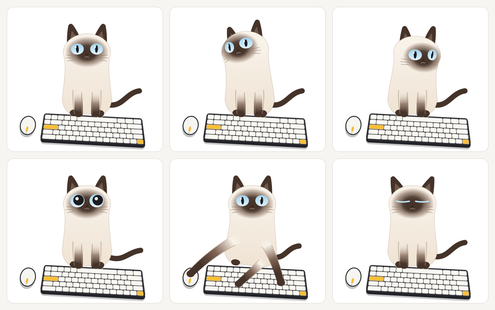
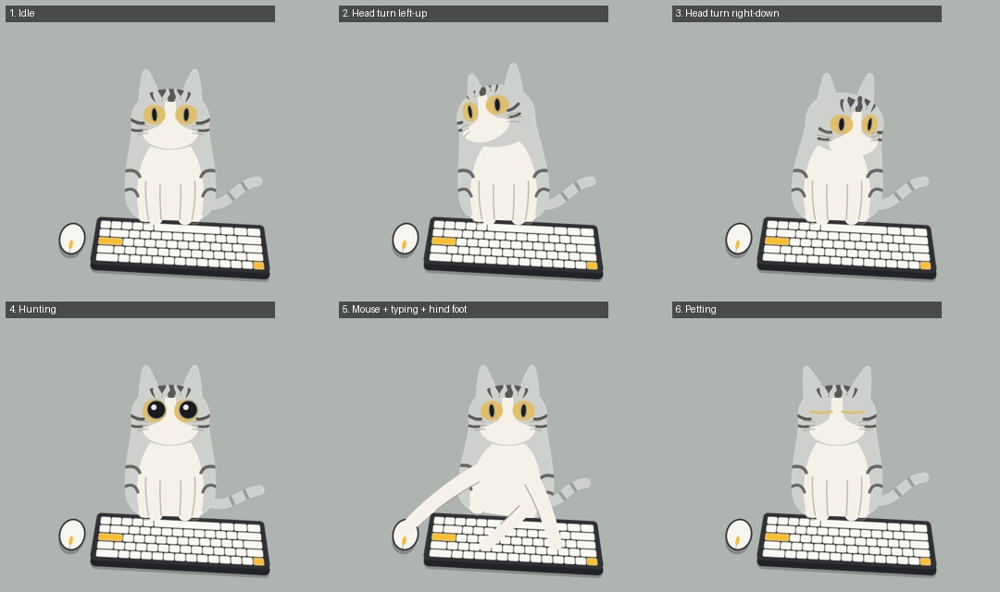
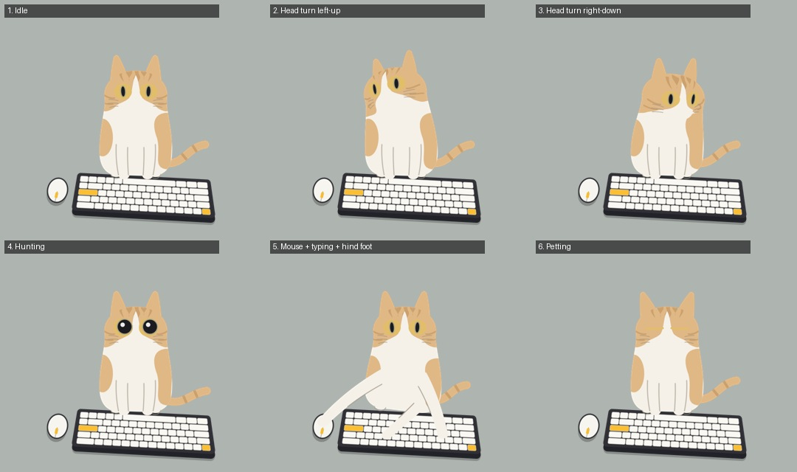

# 🐱 KuroCat — Full-State Keyboard & Mouse Desktop Cat Pet (macOS / Windows / Linux / UOS)

<p align="center">
  <a href="README.md">简体中文</a> | <b>English</b>
</p>

<p align="center">
  
  
  
</p>

<p align="center">
  <b>Ultra-lightweight native desktop pet · Hardware-level full-state capture for typing &amp; gaming · 2.5D spherical head tracking · Hunting boba eyes · 4 switchable skins</b><br/>
  Native macOS (Swift + CoreGraphics + IOHIDManager) · Windows (C++17 + GDI+ + Raw Input) · Linux / UOS (C++17 + GTK3/Cairo + XInput2/evdev)
</p>

> This repository is a fork of [chanke17/KuroCat](https://github.com/chanke17/KuroCat). The current release is [v1.3.5](https://github.com/andyforfun168/KuroCatAndy/releases/tag/v1.3.5), with an orange-eye app icon, update notices, and the approved Shorthair / Orange & White rendering fixes. Download and update from [this fork's Releases](https://github.com/andyforfun168/KuroCatAndy/releases/latest).

---

## ✨ Highlights

- **🎮 Full-State Input Capture for Typing & Gaming (True NKRO)**
  - **macOS**: Dual-layer `IOHIDManager` (kernel HID hardware layer) + `CGEventTap`, unaffected by IME switching. Supports holding `WASD` in games, key combinations, standalone modifier keys (`⌘ / ⇧ / ⌥ / ⌃ / Fn`), arrow keys, and `F1–F12`.
  - **Windows**: Native `Raw Input API (RIDEV_INPUTSINK)` hardware scan-code listener. Captures global keystrokes and mouse micro-movements even inside DirectX/Vulkan games with locked cursor.
  - **Linux & UOS (统信 UOS)**: Dual-layer `XInput2 (XI_RawKeyPress/Motion)` + kernel `evdev (/dev/input/event*)`. **Works out of the box without `sudo` on UOS / Deepin / Ubuntu X11 desktops**; on Wayland, add your user to the `input` group for hardware-level full-state capture.
- **🌀 2.5D Spherical Head Tracking & Natural Perspective**
  - Uses a Live2D-style spherical projection algorithm: the cat's head, ears, eyes, and whiskers rotate with realistic 2.5D perspective and parallax toward your cursor. The keyboard and mouse are oriented 180° facing the cat, matching your left-hand keyboard / right-hand mouse gaming posture.
- **⚡ Hunting Boba Eyes Mode**
  - Shake your mouse quickly and the cat's pupils dilate from slit pupils into huge round boba eyes with bright highlights—crouching low, wagging its tail faster, and locking onto the cursor without blinking.
- **🐾 Fun Interactive Details**
  - **3-Key "Hind Paw Press"**: Hold 3 or more keys simultaneously and the cat lifts its hind paw to press the 3rd key!
  - **Head / Back Petting**: Gently stroke the cat's head with your cursor to trigger cozy closed eyes `— —` and shimmer particles; leave it idle and it falls asleep with floating `z`s.
  - **Smart Click-Through, Launch at Login & Auto Update Check**: Transparent areas pass clicks through automatically. Toggle **Full Click-Through (Gaming Anti-Misclick)** anytime, enable **Launch at Login** (Windows Registry / macOS LaunchAgent / Linux XDG Autostart), and check this fork for updates at most once per day. Update notices open its GitHub download page.
- **🎨 4 Skins & Custom Color Combinations**
  - **Cat Skins**: Classic Black Cat (neon yellow-green eyes) / Siamese Cat (warm oat cream + 2.5D caramel mask + chocolate socks + sapphire blue eyes) / American Shorthair (silver tabby & white) / Orange & White Cat (orange crown + white chest & mittens)
  - **Keyboard Themes**: Classic Warm Cream / Midnight Geek Black / Retro Cream Gray (toggle key bubbles)
  - **Eye Colors & Scaling**: 6 eye colors, 5 size levels, plus daily keystroke counter and live KPM stats.

### 6-State Preview of All 4 Skins

| Classic Black Cat | Siamese Cat |
| :---: | :---: |
|  |  |

| American Shorthair | Orange & White Cat |
| :---: | :---: |
|  |  |

The 6-state previews are natively rendered by the app: Idle, Top-Left Look, Bottom-Right Look, Hunting, Keyboard/Mouse + 3rd Paw, and Petting Closed Eyes. The Shorthair and Orange & White images retain this fork’s approved v1.3.5 artwork and use the optional pale-gold / teal eye color.

---

## 📦 Download & Run

Download pre-built binaries from **[Releases](../../releases)** (built automatically via GitHub Actions):

### 🍎 macOS (Universal: Apple Silicon & Intel · macOS 13+)
1. Download `KuroCat-macOS-universal.zip`, unzip it, and drag `KuroCat.app` into **Applications** (lives in the top menu bar, no Dock icon).
2. On first launch, click the bottom prompt pill to open **System Settings → Privacy & Security → Input Monitoring**, enable `KuroCat`, then click **Restart KuroCat** from the menu bar to enable global typing & gaming capture.
3. Supports one-click **Launch at Login**. When **Full Click-Through** is enabled, use the menu bar icon or **hold `⌥ Option` and right-click / drag the cat**.

**Build from source:**
```bash
chmod +x build.sh
./build.sh
open KuroCat.app
```

### 🪟 Windows (Windows 10 / 11 x64)
1. Download the single-file `KuroCat-Windows-x64.exe` (~382 KB, **zero external runtime dependencies**). Double-click to run; lives in the system tray.
2. Right-click the cat or click the tray icon to switch skins, keyboard themes, scale, **Launch at Login**, or **Full Click-Through**.
3. **4 ways to exit or open the menu while Full Click-Through is active**:
   - Global shortcut: **`Ctrl + Alt + Shift + P`** to toggle click-through;
   - Temporary unlock: hold **`Alt`** and right-click the cat to uncheck or left-drag to move;
   - System tray: click the black cat icon in the **`^` hidden icons area** on the taskbar;
   - Fallback: **double-click `KuroCat.exe` again** to disable click-through and open the settings menu at your cursor.
   > **Cat follows the mouse but not the keyboard in a game?** If the game or launcher runs as Administrator, right-click `KuroCat-Windows-x64.exe` and choose **Run as administrator**.
   >
   > **Cat disappears in a game?** Try borderless/windowed fullscreen instead of exclusive fullscreen.
   >
   > **Still prompted to update?** Quit the old copy from the tray menu before starting the new exe. Downloading a file does not replace the running process.

**Build from source (MSVC / MinGW):**
```bat
cd windows
build.bat
```
Or with CMake:
```bat
cd windows
cmake -B build && cmake --build build --config Release
```

### 🐧 Linux & UOS / Kylin (x86_64 & ARM64)

This fork's pre-built packages use Ubuntu 22.04 as their build baseline. Older Ubuntu / Debian / UOS systems may require a local build. X11 is preferred; Wayland behavior depends on the desktop environment. See [installation and troubleshooting](docs/DOWNLOADS.md) (Chinese).

1. **Debian / Ubuntu / UOS / Kylin**: download `KuroCat-Linux-amd64.deb` (Intel / AMD) or `KuroCat-Linux-arm64.deb` (ARM64), then install with your package manager or:
   ```bash
   sudo apt install ./KuroCat-Linux-amd64.deb
   ```
   Launch **KuroCat** from the application menu or run `kurocat`.
2. **Other Linux distributions**: extract `KuroCat-Linux-x86_64.tar.gz` or `KuroCat-Linux-arm64.tar.gz` and run `./kurocat`. Read the included `INSTALL.txt` for runtime requirements.
3. **Wayland input**: adding your user to the `input` group enables access to raw input devices. Run `sudo usermod -aG input $USER` and log in again; this grants access to all input devices and does not remove Wayland window-management limitations.
4. **Build from source**:
   ```bash
   sudo apt install g++ pkg-config libgtk-3-dev libcairo2-dev libx11-dev libxi-dev
   cd linux && chmod +x build.sh build_deb.sh
   ./build.sh
   ./build_deb.sh
   ```


---

## 📁 Project Structure

```text
KuroCat/
├── Sources/                   # macOS native Swift source (Universal: Apple Silicon + Intel)
├── Resources/                 # macOS Info.plist & AppIcon.icns
├── build.sh                   # macOS universal binary build script
├── windows/                   # Windows native C++17 (Win32 + GDI+ + Raw Input)
├── linux/                     # Linux & UOS native C++17 (GTK3 + Cairo + XInput2 + evdev)
│   ├── src/                   # KeyMap / InputEngine / CatPhysics / CatRenderer / main.cpp
│   ├── build.sh               # Local build script
│   └── build_deb.sh           # Debian / UOS .deb packager
└── .github/workflows/build.yml # Automated multi-platform release workflow
```

---

## 🔒 Privacy

Keyboard and mouse input is processed in local memory to drive animations and counters. Keystroke contents are not logged, saved, or uploaded.

Update checks read public release metadata from this fork's GitHub Release API, automatically at most once per day or manually from **Check for Updates…**. Requests include your IP address and an application-version User-Agent, but no keystrokes, mouse trails, or usage statistics. Automatic checks can be disabled. Notices open the download page; they do not download, install, or replace the application.

Users on v1.3.0 or earlier must upgrade manually once to receive in-app update notices.

## Contributors

Thanks to the original author and contributors:

| [<br/>chanke17](https://github.com/chanke17) | [<br/>andyforfun168](https://github.com/andyforfun168) |
| :---: | :---: |
| Original KuroCat author, core features and maintenance | Fork maintainer; Shorthair / Orange & White skins, rendering fixes, orange-eye icon and update notices |

[Fork contribution history](https://github.com/andyforfun168/KuroCatAndy/graphs/contributors) · [Upstream project](https://github.com/chanke17/KuroCat)

## 📄 License

[MIT License](LICENSE)
