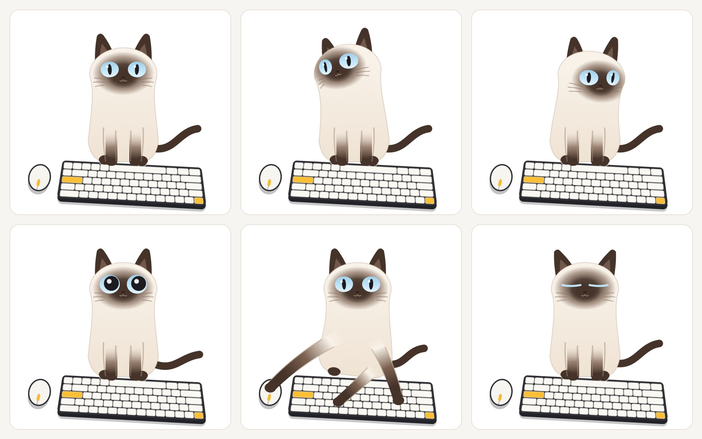
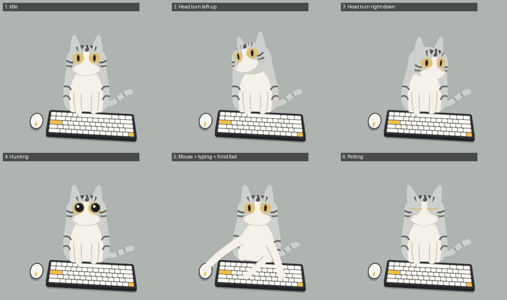
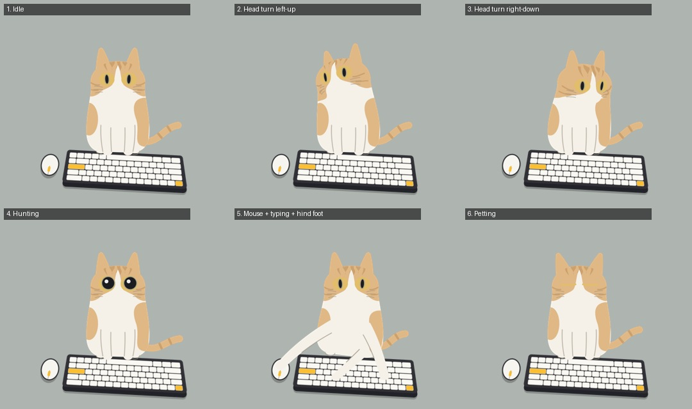

# 🐱 KuroCat — 全状态键盘鼠标桌面萌猫 (macOS / Windows / Linux / 统信 UOS)

<p align="center">
  <b>简体中文</b> | <a href="README.en.md">English</a>
</p>

v1.4.2 同步原作者 v1.4.1 的原生设置、自定义键盘、旋转与拖拽物理及 v1.4.0 全部新功能；保留定稿白手臂、默认瞳色和橙眼图标，修复睡觉尾根白边与生气眉毛，不包含前扑实验动画，也没有应用内更新功能。

<p align="center">
  
  
  
</p>

<p align="center">
  <b>超轻量级原生桌面宠物 · 打字 & 玩游戏全状态硬件级监听 · 2.5D 球面转头 · 捕猎大圆眼 · 四款皮肤自由切换</b><br/>
  Native macOS (Swift + CoreGraphics + IOHIDManager) · Windows (C++17 + GDI+ + Raw Input) · Linux / 统信 UOS (C++17 + GTK3/Cairo + XInput2/evdev)
</p>

> 本仓库是 [chanke17/KuroCat](https://github.com/chanke17/KuroCat) 的 fork。v1.3.6 同步新版暹罗猫、只摸头互动、快速甩鼠捕猎、键盘字符与点击气泡、平台修复及 Linux 免密码安装；保留橙眼图标和本 fork 已确认的美短 / 橘白外观，移除全部应用内更新功能。请从[本仓库 Release](https://github.com/andyforfun168/KuroCatAndy/releases/latest)手动下载。

---

## ✨ 特性亮点

- **🎮 打字 & 玩游戏全状态接收（真正全键无冲 NKRO）**
  - **macOS**：双层架构 `IOHIDManager`（内核 HID 硬件层）+ `CGEventTap`，不受中英文输入法干扰，完整支持游戏里长按 `WASD`、组合快捷键、单独修饰键（`⌘ / ⇧ / ⌥ / ⌃ / Fn`）、方向键与 `F1–F12`。
  - **Windows**：原生 `Raw Input API (RIDEV_INPUTSINK)` 硬件扫描码监听，打字与 DirectX/Vulkan 游戏内按键、鼠标锁定微动均可全局捕获。
  - **Linux & 统信 UOS**：双层 `XInput2 (XI_RawKeyPress/Motion)` + 内核 `evdev (/dev/input/event*)`，**在统信 UOS / Deepin / Ubuntu X11 桌面下双击即用、免 sudo 即可全局监听打字与游戏按键**；Wayland 下加入 `input` 组即可开启硬件级全状态监听。
- **🌀 2.5D 球面转头 & 真实面向视角**
  - 猫头、双耳、双眼、胡须和脸部花纹随鼠标产生 2.5D 透视转头与视差；美短和橘白的粉色鼻子与嘴巴也跟随头部转动。
  - 键盘与鼠标 180° 朝向小猫摆放，小猫左手键盘、右手鼠标，保留自然的肩部连接和手臂动作。
- **⚡ 捕猎大圆眼模式**
  - 快速晃动鼠标时，瞳孔从竖瞳逐渐扩张为大圆眼与白色高光，身子压低、尾巴加快摆动；持续快速甩鼠还会触发原有的眩晕动作。
- **🐾 丰富交互彩蛋**
  - **键盘联动**：同时按住 3 个及以上按键时，小猫会抬后脚按键；刚好按住 4 个物理键时，还会用尾巴帮忙。
  - **摸头与表情**：轻摸猫头会露出惬意闭眼与微光粒子；支持打哈欠和快速打字生气表情，生气效果可在设置中开关。
  - **尾巴互动**：鼠标靠近尾巴时，小猫会甩尾躲闪并自然回弹。
- **🌈 键盘跑马灯与按键气泡**
  - RGB 跑马灯流光随键盘互动变化，按键会实时亮起；键盘字符、按键与点击气泡及跑马灯均可在「设置 → 互动与特效」开关。
- **🤏 拎起小猫 & 随身键鼠（macOS v1.4.3）**
  - 长按拖动小猫，鼠标逐渐贴近背部抓取点；拎起后背部两侧轻微下垂，四肢和尾巴随移动产生惯性摆动，下巴与胸口自然衔接。
  - 小猫右手带鼠标或数位板、左手带倾斜键盘，外设跟随手部一起摆动，放下时回到原位；基础四款皮肤均已适配。
  - **甩动眩晕眼**：拎起后快速来回甩动，累计 **1.2 秒有效甩动**即可触发转圈眼；只改变表情，不晕倒。松手或重新拎起不重置 **2.5 秒**恢复过程，普通移动和慢速拖动不会触发。
- **💤 团睡造型 & 随瞳色闭眼线（macOS v1.4.3）**
  - 闲置后逐渐打瞌睡、闭眼并团睡；基础四款沿用原版黑猫的圆润身体与臀部轮廓，保留各自花纹、脸部和耳朵特征。
  - 修复实际自动入睡与预览不一致造成的侧边尖角，以及睡眠尾根的白边分割感，让尾巴与身体衔接自然。
  - 摸头、睡觉和半眯眼时，闭眼线跟随当前选中或自定义瞳色，例如琥珀金瞳对应金色眼缝。
- **🎨 四款皮肤 & 多配色自由搭配**
  - **猫咪皮肤**：经典小黑猫 / 挖煤暹罗猫（小耳朵、新面罩与浅冰蓝眼睛）/ 美短（银灰虎斑、平顶白色额纹）/ 橘白猫（暖橘头顶、圆润斑块与白胸）。
  - **美短与橘白**：保留纯白伸手、自然肩部连接和粉色鼻嘴；橘白拎起后的背斑缩小并圆润收边，不延伸到四肢根部以下。
  - **默认瞳色**：每次选择橘白猫自动搭配「琥珀金瞳」，选择美短自动搭配「淡金青绿」；之后仍可在「瞳色切换」中自由选择，共 6 种内置瞳色。
  - **键盘与皮肤扩展**：提供经典奶白暖黄 / 暗夜极客黑 / 复古奶油灰；换装间支持导入 / 导出 `.kurocat` 皮肤，也可导入自定义键盘，格式见[皮肤说明](docs/skin-format.md)。
- **✏️ 数位板与触控笔（macOS）**
  - 在「设置 → 互动与特效」选择自动检测、始终显示数位板与触控笔，或始终显示鼠标；支持压感笔绘制效果。
  - 正常与拎起状态均握住笔身，笔尾朝左上、笔尖接触数位板；拎起时笔、数位板和小手同步运动。
- **⚙️ 简洁菜单 & 分组设置（macOS）**
  - **日常菜单**：显示键鼠监听状态、今日击键、实时 KPM 与摸猫次数；保留显示 / 隐藏桌宠、调整大小与方向、快捷换肤、设置、重启和退出等常用入口。
  - **外观与方向**：集中管理猫咪皮肤与换装间、键盘配色与导入、瞳色、白色外描边、水平镜像、旋转和大小；支持一键回正与重置位置，也可双击小猫进入大小与方向编辑。
  - **互动与特效**：集中开关生气表情、按键与点击气泡、键盘字符及 RGB 跑马灯，并选择数位板显示模式。
  - **窗口与系统**：管理全屏置顶、完全鼠标穿透、全屏自动隐藏、开机自启及中英文界面；穿透时可按住 `⌥ Option` 临时拖动。
  - **OBS 直播捕获**：支持透明窗口与绿幕模式，也可隐藏桌面小猫、保留后台捕获，方便直播画面使用。

以上 v1.4.3 新增美术、拎起互动与分组设置说明以 **macOS 最新版**为准；Windows / Linux 当前安装包仍为 v1.4.2，部分菜单和效果有所不同。请从[本仓库 Release](https://github.com/andyforfun168/KuroCat-WorkingMode/releases/latest)手动下载，应用内不提供更新检查或自动下载安装。

### 四款皮肤 6 态预览

| 经典小黑猫 | 挖煤暹罗猫 |
| :---: | :---: |
|  |  |

| 美短（银虎斑加白） | 橘白猫 |
| :---: | :---: |
|  |  |

新增皮肤的六态图为应用原生绘制：待机、左上转头、右下转头、捕猎、键鼠与第三只脚、摸头闭眼。图中使用可选瞳色「琥珀金瞳」，两款新皮肤带有随头部投影的粉色鼻子和灰色嘴巴；每次选择橘白猫会使用「琥珀金瞳」，每次选择美短会使用「淡金青绿」；之后仍可到「瞳色切换」手动换色。

---

## 📦 下载与运行

前往右侧 **[Releases](../../releases)** 页面直接下载对应系统版本（由 GitHub Actions 自动编译）：

### 🍎 macOS (Apple Silicon & Intel 通用 · macOS 11+)
1. 下载 `KuroCat-macOS-universal.zip` 解压，将 `KuroCat.app` 拖入「应用程序」打开（常驻顶部菜单栏，不占 Dock）。
2. 首次使用点击小猫底部提示胶囊，前往 **系统设置 → 隐私与安全性 → 输入监控** 勾选 `KuroCat` 后在菜单栏点「重启 KuroCat」即可全局监听打字与游戏按键。
3. 支持在菜单中一键开启 **开机自动启动**；开启「完全鼠标穿透」后，可通过顶部菜单栏小猫图标或 **按住 `⌥ Option` 键直接右键/拖动小猫**。

**本地源码编译：**
```bash
chmod +x build.sh
./build.sh
open KuroCat.app
```

### 🪟 Windows (Windows 7 SP1 / 8 / 10 / 11 x64)
1. 下载单文件 `KuroCat-Windows-x64.exe`（约 220 KB，**零外部运行时依赖**），双击即可运行，常驻右下角系统托盘。
2. 右键小猫或左键/右键托盘小猫图标即可切换皮肤、键盘配色、尺寸、**开机自动启动**、游戏防误触穿透模式等。
3. **开启「完全鼠标穿透」后，以下 4 种方式均可随时取消或呼出菜单**：
   - 全局快捷键：**`Ctrl + Alt + Shift + P`** 一键切换/取消穿透；
   - 临时解锁：按住 **`Alt`** 键，再直接右键小猫取消勾选或左键拖动；
   - 系统托盘：点击任务栏右下角 **`^` 隐藏图标区** 中的黑猫图标（左键或右键均可弹出菜单）；
   - 保底方式：**再次双击 `KuroCat.exe`**，会自动取消穿透并直接在鼠标处弹出设置菜单。
   > **游戏里小猫只跟鼠标、不跟键盘？** 这类游戏（及 WeGame 等启动器）以管理员权限运行，Windows 会拦截它的键盘输入。右键小猫 →「以管理员身份重新启动」即可；想一劳永逸可勾选「每次启动都以管理员身份运行」。小猫检测到这种游戏时也会在托盘弹出提示。
   >
   > **进游戏小猫消失？** 小猫会在全屏/无边框游戏切到前台后自动重新置顶，游戏切换分辨率后也会自动回到屏幕内。如果游戏用的是「独占全屏」，任何桌面窗口都无法盖在上面，请在游戏设置里改成「无边框窗口 / 窗口化全屏」。
   >
   > **下载新版后仍是旧版？** 先退出托盘中的旧版，再启动新 exe；新版也支持接管旧进程。

**本地源码编译（MSVC / MinGW）：**
```bat
cd windows
build.bat
```
或使用 CMake：
```bat
cd windows
cmake -B build && cmake --build build --config Release
```

### 🐧 Linux & 统信 UOS / 银河麒麟 (x86_64 & ARM64)
支持 **Ubuntu 20.04+ / Debian 11+ / Deepin / 统信 UOS（x86_64 & ARM64 飞腾/鲲鹏）/ 银河麒麟 / Arch / Fedora**：

1. **免密码安装（推荐统信 UOS / 银河麒麟，不需要开机密码）**：
   - 下载 `KuroCat-Linux-x86_64.tar.gz`（Intel/AMD/兆芯/海光）或 `KuroCat-Linux-arm64.tar.gz`（飞腾/鲲鹏等 ARM64），解压。
   - 在解压出的文件夹里右键「在终端中打开」，执行 `bash install.sh`。程序只装到当前用户的 `~/.local`，装完自动启动，开始菜单可搜到 **KuroCat**；卸载执行 `bash uninstall.sh`。
   - 压缩包里的 `安装说明.txt` 有麒麟「应用执行控制」、统信「开发者模式」、CPU 架构不匹配等常见问题的处理方法。
2. **`.deb` 安装包（统信 UOS / Deepin / Ubuntu / Debian / 麒麟）**：
   - 双击 `KuroCat-Linux-amd64.deb` / `KuroCat-Linux-arm64.deb` 用软件包安装器安装（系统会要求输入开机密码），或终端执行：
     ```bash
     sudo apt install ./KuroCat-Linux-amd64.deb
     ```
   - 安装包在 Debian 10（glibc 2.28）环境中编译，统信 UOS 20、银河麒麟 V10 等较老的系统也能运行；使用 tar 包中的 `bash install.sh` 可安装到当前用户目录，**不再需要输入密码**。
   - **麒麟安装失败**：「安全中心」→「应用保护 / 应用执行控制」改为「关闭」或「警告」后再装，或直接用上面的免密码安装。
3. **其他 Linux 发行版（Arch / Fedora 等）**：
   - 解压 tar.gz 后运行 `bash install.sh`，或直接运行 `./kurocat`。
   - 若使用纯 **Wayland** 会话，执行一次 `sudo usermod -aG input $USER` 并重新登录即可启用 `evdev` 内核级全局监听。
4. **电脑变卡？** 默认使用省电自适应帧率（打字/移动鼠标时 30fps、空闲 20fps、睡觉 10fps）；右键小猫可开启「高帧率 60fps」，低配电脑请保持关闭。
5. **龙芯（LoongArch / MIPS）本地源码编译**：
   ```bash
   sudo apt install g++ pkg-config libgtk-3-dev libcairo2-dev libx11-dev libxi-dev
   cd linux && chmod +x build.sh build_deb.sh
   ./build.sh        # 编译可执行文件
   ./build_deb.sh    # 一键打成 .deb 安装包
   ```

---

## 📁 项目结构

```text
KuroCat/
├── Sources/                   # macOS 原生 Swift 源码 (Apple Silicon + Intel 通用)
├── Resources/                 # macOS Info.plist & AppIcon.icns
├── build.sh                   # macOS 一键通用二进制编译脚本
├── windows/                   # Windows 原生 C++17 (Win32 + GDI+ + Raw Input)
├── linux/                     # Linux & 统信 UOS 原生 C++17 (GTK3 + Cairo + XInput2 + evdev)
│   ├── src/                   # KeyMap / InputEngine / CatPhysics / CatRenderer / main.cpp
│   ├── build.sh               # 本地编译脚本
│   └── build_deb.sh           # 一键打包 Debian / 统信 UOS .deb 安装包
└── .github/workflows/build.yml # macOS + Windows + Linux (x86_64 & arm64) 全平台自动发版
```

---

## 🔒 隐私说明

键盘和鼠标输入仅在本地驱动动画与计数，不记录或上传按键内容。本 fork 已移除应用内更新检查、更新提醒和自动下载安装；需要更新时请手动前往本仓库的 [GitHub Release](https://github.com/andyforfun168/KuroCatAndy/releases/latest)。

## 📄 License

[MIT License](LICENSE)
